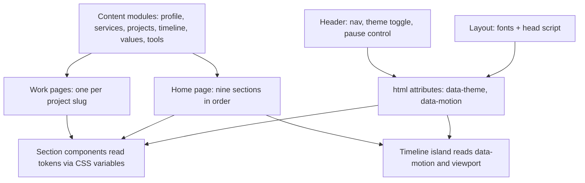

# Portfolio Revamp - Plan

## Goal Capsule

- **Objective:** A visitor, hiring managers first and consulting clients second, sees a portfolio that is clearly one person's own work and not a template, and is moved to get in touch.
- **Means:** Rebuild the existing Next.js site as one launch around the theme in `Design.md` and the section references in `reference.md`, built with no animation library (KTD4).
- **Product authority:** The site owner decides scope, copy and what employer work is safe to publish. Both reference files are inputs, not specs.
- **Stop conditions:** Stop and ask if the owner has not approved employer-project detail for a case study, if a booking link is missing for the contact section, or if the host serving the live site turns out to need server features.
- **Execution profile:** Frontend-only, static-export compatible. Pure logic is tested first; layout and motion are verified in a browser.
- **Open blockers:** None. Content approval and the booking link are launch gates owned by the owner, not planning blockers.

---

## Product Contract

**Product Contract preservation:** changed: R13, education and certification entries appended after the company panels (confirmed in planning); all other requirements unchanged.

### Summary

The portfolio becomes a nine-section dark editorial page in the Mike Wilcock theme: hero, about, skills strip, services, projects, tools, values, work timeline, contact. Every project gets its own case-study page. The work timeline is a pinned horizontal slide in the style of Alex Van Holtz's site. The Firebase and Genkit leftovers and the contact form are removed.

### Problem Frame

The current site reads as generic and template-like, which the owner describes as "AI slop". It is a standard single-page layout with default component styling, and the repo still carries Firebase and Genkit scaffolding from its generator. The owner has collected specific sections from five sites they admire. This plan turns those references into one coherent product.

### Key Decisions

- **Audience is both, hiring first.** Hiring managers and recruiters lead; consulting clients are secondary. Governs R4, R8. (session-settled: user-directed — chosen over consulting-first and peers-only: the site is mainly a job-search tool.)
- **Hero, projects and the work timeline are the priority sections.** They get the most design and content effort. Governs R5, R9, R13. (session-settled: user-directed — chosen over a different top three from the seven reference sections: these do the most to remove the template feel.)
- **Section order is fixed.** Projects sit right after services. Governs R4. (session-settled: user-directed — chosen over placing projects after the hero or after the tools: proof follows the services pitch.)
- **Services are five cards, not four.** The four owner keywords plus "Streaming & Lakehouse". Governs R8. (session-settled: user-directed — chosen over four cards: the fifth covers the newest repos and recent senior-role demand.)
- **The timeline is a pinned horizontal slide.** Governs R13. (session-settled: user-directed — chosen over an expandable list, a split view and a drawer timeline after seeing sketches: the owner wants the interactive slide from Alex Van Holtz's site.)
- **Every project gets a case-study page, covering public repos and employer work.** Governs R9, R10. (session-settled: user-directed — chosen over case studies for the featured few, GitHub links only, and modals: strongest hiring signal.)
- **Dark by default with a light toggle.** Governs R1, R2. (session-settled: user-directed — chosen over dark only: keeps the toggle the current site has.)
- **Contact is Email plus Book a call.** Governs R14. (session-settled: user-approved — Email + Book a call proposed with the contact form dropped; the owner assented.)
- **One launch, not phased.** Governs the whole plan. (session-settled: user-directed — chosen over a spine-first build and a spine-first build with a diagram signature: the owner wants everything together.)
- **Firebase and Genkit leftovers are removed.** Governs R15. (session-settled: user-directed — chosen over leaving them as out of scope: the owner asked for removal.)

### Requirements

**Look and feel**

- R1. The site uses the visual system in `Design.md`: warm near-black background, one periwinkle accent, Archivo display type with Geist Mono labels, and hairline dividers in place of cards and shadows.
- R2. Dark is the default theme and a visible toggle switches to a light theme with a palette derived from the dark one. The chosen theme persists across visits.
- R3. All motion sits behind one master switch. A visible control pauses it, and `prefers-reduced-motion` disables it by default.

**Page structure**

- R4. The page presents these sections in order: hero, about, skills strip, services, projects, tools, values, work timeline, contact. A fixed header links to them.
- R5. The hero follows the Mike Wilcock pattern: name, a one-line statement of what I do, an audience line, a scroll cue, a "See the work" link, and a looping strip of capability words.
- R6. The about section gives a short intro with a profile photo, replacing the current about copy.
- R7. The skills strip is a looping ticker of the owner's main skill categories, in the Mike Wilcock marquee style.
- R8. Services are five numbered cards, each with a one-line description: Data Modelling, Data Pipelines, Data Scraping, AI Automation, and Streaming & Lakehouse. The section ends with a "Let's talk" link to contact.
- R9. Projects are a card grid in the Arturo Spatino style. Each card shows a cover image, project name and category tag, and links to that project's case-study page. The grid covers the streaming lakehouse, the other public repos, and the employer projects (BigQuery modernization, Airflow and DAG Factory, hybrid ClickHouse and BigQuery warehouse, Superset platform).
- R10. Each case-study page follows one template: problem, architecture, stack, results, and a repo link where the repo is public. Employer projects show only the detail the owner has approved.
- R11. Tools are a logo strip in the itsjay.us "Professional at" style, each logo linking to the tool's site.
- R12. Values are numbered first-person principles in the Alex Van Holtz style, targeting six.
- R13. The work timeline is a pinned horizontal slide: vertical scroll moves a track left and right under a year bar with a progress line and a position marker. Years in the bar jump to their entry. Each company (Farmbyte, Dibimbing.id, Ismaya Group, SIRCLO) has a panel with its own scrollable detail: role, period, achievements and stack. Education and certifications follow as two final non-company entries. Work only otherwise, no personal entries.
- R14. The closing section is the Astapable pattern: a large headline, "Email Me" and "Book a Call" buttons, and a footer block with name, title and location. The CV download stays reachable.

**Cleanup and content**

- R15. The Firebase and Genkit leftovers are removed, along with the contact form.
- R16. All new copy (about, values, services lines, case studies) is drafted from the owner's CV and repo READMEs and reviewed by the owner before launch.

### Acceptance Examples

- AE1. **Covers R13.** Given a viewport narrower than 1025px, the timeline renders as a plain vertical list of company panels with no pinning or horizontal movement.
- AE2. **Covers R3, R13.** Given `prefers-reduced-motion`, the pinned slide, tickers and reveal animations are off, and all timeline content stays reachable by normal scrolling.
- AE3. **Covers R2.** Given a first visit, the site renders dark; after the visitor toggles to light and reloads, it renders light.
- AE4. **Covers R10.** Given an employer project with no approved detail beyond a summary, its case-study page shows only that summary and does not invent architecture or numbers.

### Success Criteria

- A reviewer can tell each section's reference without being told, and the page does not read as a template.
- The page works on phone and desktop, in both themes, with motion on and off.
- Text meets WCAG AA contrast in both themes, including the muted label colors.

### Scope Boundaries

- The contact form is replaced, not kept alongside the new buttons.
- Services cards do not link to separate service detail pages.
- A blog, a CMS and any backend features are not part of this work.
- Architecture-diagram covers and a data-flow motif were offered and not chosen. Covers can be any images the owner supplies.

#### Deferred to Follow-Up Work

- Pruning the unused shadcn component files and the form dependencies (`react-hook-form`, `zod`, `@hookform/resolvers`) once nothing imports them.
- Turning off `ignoreBuildErrors` and `ignoreDuringBuilds` in `next.config.ts`. This plan runs a type check instead and leaves the flags alone.
- Adding Netlify build configuration, if the owner confirms Netlify serves the site and needs it.

### Dependencies / Assumptions

- Fonts are Archivo and Geist Mono, both free to use.
- The owner supplies or approves how much employer-project detail is public, and supplies a booking link for "Book a Call". (Assumption: not yet provided.)
- The case studies, values and about text are drafted for the owner's review, not supplied by the owner.
- The live site at `https://salbifaza.netlify.app/` is served from this repo. This is unconfirmed: the repo has a GitHub Pages workflow and no `netlify.toml`, and the deployed page is about 14 months old.
- The repo is on Next.js 15.3, React 18 and Tailwind 3.4, with no animation library installed.

### Outstanding Questions

**Resolve Before Planning**

- None.

**Deferred to Planning**

- Which host the owner deploys to, after checking Netlify's linked repo. The plan stays compatible with both (KTD9).
- Which skill categories fill the skills strip and which logos fill the tools strip. These are content choices made in U3.

### Sources / Research

- `reference.md` records the section references: mikewilcockdesign.com (hero, services), alexvanholtz.com (values, timeline), arturospatino.com (projects), itsjay.us (tools) and astapable.com (contact).
- `Design.md` records the theme extracted from mikewilcockdesign.com.
- `src/data/portfolio-data.ts` holds the current copy, experience, projects, education and certifications.
- The Alex Van Holtz timeline mechanics (pinned section, horizontal track, year bar, stacked fallback below 1025px) were read from that site's published CSS and script.

---

## Planning Contract

### Key Technical Decisions

- KTD1. **Server components for sections, small client islands for behavior.** Sections render on the server from content modules. Only the theme and motion toggles, the header (menu and active-section state), the reveal wrapper and the timeline are client components. `/work/[slug]` pages are pre-rendered from the content module with static params. Rationale: the current page is one large client component, which is unnecessary and slows first paint. Governs R4, R9, R10.
- KTD2. **Themes are CSS variables keyed on a `data-theme` attribute.** Color tokens from `Design.md` are defined for dark (default) and a derived light set. Tailwind's `theme.extend.colors` points at the variables. A small blocking script in the document head sets the attribute from stored preference before first paint, defaulting to dark, so there is no flash. Rationale: the existing toggle defaults to light and sets a class after hydration, which would flash light on every load. Governs R1, R2, AE3. (session-settled: user-directed — chosen over dark only: keeps the toggle the current site has.)
- KTD3. **One motion switch.** A `data-motion` attribute on the document root is set by the same head script from a stored choice, defaulting to off when `prefers-reduced-motion` is set. Every animation and scroll effect checks it, and the header's pause control flips it. Rationale: one switch is simple to test and satisfies both the reduced-motion and the pause requirements. Governs R3, AE2.
- KTD4. **No animation library and no smooth-scroll library.** Marquees are CSS keyframes on a duplicated track with their play state gated by the motion switch. Reveals use `IntersectionObserver` to add a class. The timeline uses a sticky pin and one throttled scroll handler. Rationale: this matches how the reference sites do it, avoids new dependencies, and keeps the pinned section compatible with native scrolling. Lenis and GSAP are left out. Governs R3, R5, R7, R13.
- KTD5. **The timeline pins a section taller than the viewport and maps scroll to a horizontal offset.** The section's height is one viewport plus the track's overflow width. A scroll handler turns scroll position into progress between 0 and 1, which sets the track's horizontal translation, the progress line and the marker. Year buttons scroll to the position of their panel. Below 1025px, with motion off, or without script, panels render as a normal vertical stack. The default markup is the stacked layout, and the pinned behavior is added when conditions allow. Governs R13, AE1, AE2. (session-settled: user-directed — chosen over an expandable list, a split view and a drawer timeline: the owner wants the interactive slide from Alex Van Holtz's site.)
- KTD6. **Content lives in typed modules, not a CMS or MDX.** Services, projects, case studies, timeline, values, tools, skills and education are typed data under one content directory, replacing the current single data file. Case studies are structured fields (problem, architecture, stack, results, links) with a detail level of `summary` or `full`, so an employer project can ship at summary level (AE4). Rationale: no new dependency, and a test can check the data. Governs R9, R10, R16, AE4.
- KTD7. **Fonts load through `next/font/google`.** Archivo is loaded as a variable font with its width axis, and Geist Mono at weight 400, both exposed as CSS variables. Rationale: self-hosted, no layout shift, matches `Design.md`. Governs R1. The width axis availability is confirmed when U2 is built.
- KTD8. **Vitest for pure logic only.** The repo has no test framework. Add Vitest in a node environment for the progress mapping, the theme and motion preference rules, and a content integrity check. No DOM or browser test framework is added. Rationale: the logic that can silently break is small and pure, while layout and motion need a real browser. Governs the Verification Contract.
- KTD9. **Stay static-export compatible and leave hosting unchanged.** No route handlers, server actions or runtime-only features. Links go through Next primitives, and every `public/` asset reference (profile photo, CV, logos, covers) resolves under the configured base path through one small helper, so a GitHub Pages base path works as well as Netlify's root. The existing GitHub Pages workflow is left as it is. Rationale: the serving host is unconfirmed, and this keeps both options open. Governs the whole plan.
- KTD10. **Project covers fall back to a generated typographic cover.** A card without a supplied image renders the project name in display type on a token background, so no card ships with a broken or placeholder image. Rationale: the owner is not obliged to supply 11 images. Governs R9.

### High-Level Technical Design

*Page composition and data flow.* This is the shape the units build, not code.



*Timeline mapping.* Directional pseudo-code for the scroll-to-slide rule (KTD5).

```text
section height = viewport height + (track width - viewport width)
progress       = clamp((scrollY - sectionTop) / (section height - viewport height), 0, 1)
track offset   = -progress * (track width - viewport width)
marker position = progress * year-bar width
year button    -> scrollY = sectionTop + (panel left / (track width - viewport width)) * (section height - viewport height)
pinned only when: viewport >= 1025px AND motion is on AND script has run; otherwise stacked
```

### Assumptions

- The profile photo and the CV file already in `public/` are reused.
- Tool logos can be authored as inline or static SVGs without a new dependency.
- Archivo's width axis is available through `next/font/google` in the installed Next version. If it is not, fall back to loading the font files directly (confirmed in U2).

### Risks & Dependencies

| Risk | Mitigation |
|---|---|
| The pinned timeline stutters or breaks on phones and short viewports. | The stacked layout is the default and below 1025px is the only layout (KTD5). Test on a short desktop window too. |
| Light palette fails contrast, especially label colors. | Check each token pair against WCAG AA in U2 and adjust the derived palette. |
| Eleven case studies are a large writing job and employer detail may be confidential. | Drafts come from the CV and READMEs, with `summary` level as the safe default (KTD6, AE4). The owner approves before launch. |
| `ignoreBuildErrors` hides type errors in the build. | The type check runs as its own verification step in every unit. |
| A GitHub Pages base path breaks asset links that Netlify would serve fine. | All links and assets use Next primitives (KTD9). Build once with a base path set to confirm. |
| The reference themes depend on motion that is hard to verify by tests. | Each motion unit lists browser checks for motion on and off, in both themes. |

### Documentation / Operational Notes

- Replace the Firebase Studio `README.md` with a short project README: what it is, how to run it, how to add a project.
- The owner needs to confirm which host serves the site and provide a booking link before launch.

---

## Implementation Units

### U1. Remove Firebase and Genkit leftovers, add test baseline

**Goal:** Start from a clean repo with a working test runner and a passing build.

**Requirements:** R15 (cleanup half; the contact form goes in U8).

**Dependencies:** none.

**Files:**
- Delete: `apphosting.yaml`, `.idx/`, `.modified`, `src/ai/genkit.ts`, `src/ai/dev.ts`, `docs/blueprint.md`
- Modify: `package.json` (remove the `genkit:*` scripts and the `genkit`, `@genkit-ai/*`, `genkit-cli`, `firebase` and `patch-package` dependencies when nothing uses them; add `vitest` and a `test` script), `package-lock.json`, `.gitignore` (remove the `.genkit` entry), `README.md`
- Create: `vitest.config.ts`, `src/lib/__tests__/smoke.test.ts`

**Approach:**
- Confirm nothing else imports the removed packages: the only source import is `src/ai/genkit.ts`, and there is no `patches` directory for `patch-package`.
- Rewrite the README as described under Documentation.
- Keep the unused shadcn components and form dependencies (deferred, see Scope Boundaries).
- Give the Vitest config the same `@/` path alias as `tsconfig.json`, so later tests can import through `@/content` and `@/lib`.

**Patterns to follow:** existing `typecheck` script in `package.json`.

**Test scenarios:**
- Happy path: the smoke test runs under `npm test` and passes.

**Verification:** `npm run typecheck`, `npm test` and `npm run build` all pass, and a search for `genkit` and `firebase` in `src/` and `package.json` finds nothing.

### U2. Theme, fonts, motion switch and site shell

**Goal:** A dark-default themed shell with fonts, a light toggle, a pause control and the fixed header.

**Requirements:** R1, R2, R3, R4 (header). Honors AE2 and AE3.

**Dependencies:** U1.

**Files:**
- Modify: `src/app/layout.tsx`, `src/app/globals.css`, `tailwind.config.ts`
- Create: `src/lib/theme.ts`, `src/lib/motion.ts`, `src/lib/asset-path.ts`, `src/components/site/header.tsx`, `src/components/site/theme-toggle.tsx`, `src/components/site/motion-toggle.tsx`, `src/components/site/footer-info.tsx`, `src/components/primitives/eyebrow.tsx`, `src/components/primitives/pill-button.tsx`, `src/components/primitives/chip.tsx`, `src/components/primitives/reveal.tsx`
- Test: `src/lib/__tests__/theme.test.ts`, `src/lib/__tests__/motion.test.ts`
- Leave in place: `src/components/theme-toggle.tsx`, `src/components/site-header.tsx` (the old page still imports them; U8 removes them)

**Approach:**
- Header section links resolve to `/#section` so they work from case-study pages. The active-section dot applies only on the home page.
- Create `src/lib/asset-path.ts` with one helper that prepends the configured base path to a `public/` asset path (KTD9). Every later unit uses it for photos, logos, covers and the CV.
- Tokens, type recipes and component patterns come from `Design.md` sections 2 to 6 and are owned by it (cite, don't copy). Derive the light palette from the dark one and check contrast per KTD2.
- Head script and attributes follow KTD2 and KTD3. The preference rules live in `src/lib/theme.ts` and `src/lib/motion.ts` as pure functions so tests can reach them.
- Header: three-column grid, fixed, gradient fade, mono links with an accent dot on the active section, pill CTA, and a mobile menu below 901px.
- `reveal.tsx` uses `IntersectionObserver` and does nothing when motion is off.

**Execution note:** Write the preference-rule tests first.

**Patterns to follow:** `Design.md` section 5 (header, buttons, chips) and the existing `suppressHydrationWarning` on `<html>`.

**Test scenarios:**
- Covers AE3. Happy path: with no stored value, the theme rule returns dark.
- Happy path: with a stored light value, the theme rule returns light.
- Edge case: an unknown stored value is ignored and returns dark.
- Covers AE2. Happy path: with `prefers-reduced-motion` set and nothing stored, the motion rule returns off.
- Edge case: a stored "on" with `prefers-reduced-motion` set returns on, since the visitor chose it.
- Error path: storage access throwing falls back to dark and the system motion preference.

**Verification:** The page loads dark with no flash, toggling to light survives a reload, the pause control stops motion, and the header works on a phone width. Contrast checks pass in both themes.

### U3. Content model and drafted copy

**Goal:** Every section and case study reads from typed content, drafted from the CV and READMEs for the owner to review.

**Requirements:** R8, R9, R10, R12, R13 (data), R16. Honors AE4.

**Dependencies:** U1.

**Files:**
- Create: `src/content/types.ts`, `src/content/profile.ts`, `src/content/services.ts`, `src/content/projects.ts`, `src/content/timeline.ts`, `src/content/values.ts`, `src/content/tools.ts`, `src/content/skills.ts`, `src/content/index.ts`
- Test: `src/content/__tests__/content-integrity.test.ts`
- Leave in place: `src/data/portfolio-data.ts` (the old components still import it; U8 removes it)

**Approach:**
- Types per KTD6, with a detail level of `summary` or `full` on every case study.
- Migrate the current experience, projects, education and certifications. Add the public repos from the repo list (`stream-flink-fluss`, `stream-debezium-kafka`, `stream-cdc-peerdb`, `data-platform-gitops`, `lakehouse-iceberg-batch`, `batch-airflow-dlt-dbt`) with case-study drafts read from their READMEs.
- Draft the about, values (six), services lines and timeline detail from the CV. Mark every employer project `summary` until the owner approves more.
- Education and certifications become two final timeline entries with no company.
- Choose the skills-strip categories and tools-strip logos here.

**Execution note:** Write the integrity test first, against the types.

**Test scenarios:**
- Covers AE4. Happy path: every project with `summary` detail has no architecture or results fields populated.
- Happy path: every project slug is unique and URL-safe.
- Happy path: every project listed in the grid has a case study.
- Happy path: there are exactly five services.
- Edge case: the timeline has the four companies in reverse-chronological order, followed by the two non-company entries.
- Error path: a project missing a category tag fails the check.

**Verification:** `npm test` and `npm run typecheck` pass, and the owner can read every drafted text from one place.

### U4. Marquee, hero, skills strip and tools strip

**Goal:** The top of the page and the two looping strips.

**Requirements:** R5, R7, R11.

**Dependencies:** U2, U3.

**Files:**
- Create: `src/components/primitives/marquee.tsx`, `src/components/sections/hero.tsx`, `src/components/sections/skills-strip.tsx`, `src/components/sections/tools.tsx`, `public/logos/` (tool SVGs)
- Test: none (see below)

**Approach:**
- The marquee duplicates its track and loops with CSS, gated by the motion switch (KTD3, KTD4). Words alternate between the outlined uppercase and the wide light italic treatment from `Design.md`, with the accent diamond between items.
- Hero follows R5 and `reference.md` section 1. Tool logos link out to each tool's site and sit at reduced opacity until hovered.

**Patterns to follow:** `Design.md` section 5 (marquee, hero) and section 6 (motion).

**Test scenarios:**
- Test expectation: none — presentational components; checked in the browser per Verification.

**Verification:** In a browser, both strips loop with motion on and sit still with it off. Hero reads correctly at phone and desktop widths in both themes.

### U5. About, services and values

**Goal:** The three text-led sections.

**Requirements:** R6, R8, R12.

**Dependencies:** U2, U3.

**Files:**
- Create: `src/components/sections/about.tsx`, `src/components/sections/services.tsx`, `src/components/sections/values.tsx`
- Test: none (see below)

**Approach:**
- Services render as five numbered link-free cards with a closing "Let's talk" link to the contact section (Scope Boundaries). Reuse the card pattern from `Design.md`.
- Values use an italic emphasis word in the heading and numbered entries, following `reference.md` section 6.
- About uses the existing `public/profile-photo.jpg`.

**Test scenarios:**
- Test expectation: none — presentational components; checked in the browser per Verification.

**Verification:** Five service cards render, six values render, and the "Let's talk" link lands on the contact section.

### U6. Projects grid and case-study pages

**Goal:** The projects section and one case-study page per project.

**Requirements:** R9, R10. Honors AE4.

**Dependencies:** U2, U3.

**Files:**
- Create: `src/components/sections/projects.tsx`, `src/components/case-study/cover.tsx`, `src/components/case-study/case-study-page.tsx`, `src/app/work/[slug]/page.tsx`
- Test: `src/content/__tests__/case-study-routes.test.ts`

**Approach:**
- The grid uses cards with cover, name and category tag, linking to `/work/<slug>`. The cover falls back to the generated typographic cover (KTD10).
- The page template follows R10. A `summary` project renders only the summary and repo link where public, and never empty headings (AE4).
- Pre-render all slugs with static params, set `dynamicParams` to false so unknown slugs 404 under a static export, and set per-page metadata (KTD1).
- Keep the header on case-study pages, with its section links pointing to the home page, plus a back link to the grid and the contact footer so the call to action stays reachable.

**Test scenarios:**
- Covers AE4. Happy path: the page model for a `summary` project omits the architecture and results blocks.
- Happy path: the static params list matches the project slugs exactly.
- Edge case: a project with no public repo omits the repo link.
- Error path: an unknown slug resolves to not found.

**Verification:** Every card opens a working page, the build pre-renders each one, and `summary` projects look intentional, not empty.

### U7. Work timeline: pinned horizontal slide

**Goal:** The interactive timeline from R13, with the stacked fallback.

**Requirements:** R13. Honors AE1 and AE2, and KTD5.

**Dependencies:** U2, U3.

**Files:**
- Create: `src/lib/timeline-progress.ts`, `src/components/sections/work-timeline.tsx`, `src/components/sections/timeline-pin.tsx`, `src/components/sections/timeline-panel.tsx`, `src/components/sections/timeline-year-bar.tsx`
- Test: `src/lib/__tests__/timeline-progress.test.ts`

**Approach:**
- `timeline-progress.ts` holds the pure mapping from KTD5: progress from scroll position, track offset, marker position and year-to-scroll positions.
- The server-rendered default is the stacked list. `timeline-pin.tsx` enables pinning only when the viewport is at least 1025px wide, motion is on and script has run, and reverts on resize (AE1, AE2).
- While pinned, the page owns vertical wheel input. A panel's detail column scrolls on its own only when its content overflows, and scroll passes back to the page at the start and end of that column. Overflowing columns are keyboard focusable and labeled, so keyboard users can scroll them.
- In the stacked layout, each panel's detail expands to its full height with no inner scroll container.
- Year buttons jump to their panel. Panels and year buttons are keyboard reachable, and focusing a panel scrolls the track to it.
- Direct links to the section by hash land at its start.

**Execution note:** Start with failing tests for the mapping, including its edge cases, before writing the component.

**Test scenarios:**
- Happy path: scroll at the section top gives progress 0 and offset 0.
- Happy path: scroll at the section end gives progress 1 and offset equal to the full overflow.
- Edge case: scroll before the section clamps to 0 and after it clamps to 1.
- Edge case: a track narrower than the viewport gives zero overflow and no division error.
- Happy path: a year's jump position maps back to a progress inside that panel's range.
- Covers AE1. Edge case: a viewport of 1024px selects the stacked layout and 1025px selects the pinned one.
- Covers AE2. Edge case: motion off selects the stacked layout even on a wide viewport.
- Integration scenario: resizing across 1025px switches layouts without a page reload and without losing scroll position in the section.

**Verification:** In a browser, the slide tracks scroll smoothly at desktop width, the year bar and marker agree with the visible panel, the stacked list works at phone width and with motion off, and keyboard users can reach every panel. Wheel input over a panel with a long detail scrolls that detail first, then continues the slide at both ends of the column.

### U8. Contact, page assembly, metadata and final checks

**Goal:** Close the page, put the sections in order, remove the old code and confirm it builds and deploys.

**Requirements:** R4, R14, R15 (contact form). Success Criteria.

**Dependencies:** U4, U5, U6, U7.

**Files:**
- Create: `src/components/sections/contact.tsx`
- Modify: `src/app/page.tsx`, `src/app/layout.tsx` (metadata), `public/` (CV path check)
- Remove: `src/components/page.tsx`, `src/components/hero-section.tsx`, `src/components/about-section.tsx`, `src/components/skills-section.tsx`, `src/components/experience-section.tsx`, `src/components/projects-section.tsx`, `src/components/education-section.tsx`, `src/components/contact-section.tsx`, `src/components/site-header.tsx`, `src/components/theme-toggle.tsx`, `src/components/site-footer.tsx`, `src/components/section.tsx`, `src/components/section-title.tsx`, `src/data/portfolio-data.ts`
- Test: none (see below)

**Approach:**
- All deletions of old components and the old data file happen here, in the same change that swaps `src/app/page.tsx` to the new composition, so every earlier unit still type checks.
- To check the Pages path, run one build with a temporary local `output: 'export'` and a base path set in `next.config.ts` (the way the Pages workflow sets them in CI), then confirm `out/` loads with every asset and link under the base path. Revert the temporary setting afterwards.
- The contact section follows R14: large stacked headline, `mailto:` and booking-link buttons, a footer block, and the CV download. The CV link must work under a base path (KTD9).
- `page.tsx` composes the nine sections in the R4 order as server components.
- Update the page title and description metadata and add per-page Open Graph basics.
- Confirm no import of a removed file remains. Run one build with a GitHub Pages-style base path to check links.
- Add a launch checklist to the README: owner approves employer detail, supplies the booking link, confirms the host.

**Test scenarios:**
- Test expectation: none — assembly and presentation; covered by the checks below.

**Verification:** `npm run typecheck`, `npm test` and `npm run build` pass, every section renders in order, the full browser matrix below is clean, and the contact form and old components are gone.

---

## Verification Contract

| Check | Command or method | When |
|---|---|---|
| Types | `npm run typecheck` | After every unit, since the build ignores type errors |
| Logic tests | `npm test` | After every unit |
| Production build | `npm run build` | After U1, U6, U8 |
| Base-path export build | `npm run build` with a temporary local `output: 'export'` and base path in `next.config.ts`, then check `out/` for working assets and links | U8 |
| Browser matrix | `npm run dev`, then check phone width, a 1024px and a 1025px window, and desktop, each in dark and light, each with motion on and off | After U2, U4, U5, U6, U7, U8 |
| Contrast | Check each token pair for WCAG AA | U2 and U8 |
| Content review | The owner reads and approves the drafted copy and the employer detail | Before launch |

## Definition of Done

**Global**

- All eight units are complete and their verification passes.
- Every R and AE in the Product Contract is met or has a recorded reason.
- The browser matrix is clean and the Success Criteria hold.
- Abandoned or experimental code from approaches that did not pan out is removed.
- The old section components, `src/data/portfolio-data.ts`, the contact form and the Firebase and Genkit files are gone.
- The owner has approved the drafted copy, supplied the booking link and confirmed the host.

**Per unit**

- U1: build passes with the leftovers removed and `npm test` runs.
- U2: dark-default theme, light toggle, pause control and header work with no flash.
- U3: the content integrity test passes and every text sits in the content modules.
- U4: both strips loop with motion on and stop with it off.
- U5: five services, six values and the about section render.
- U6: every project has a working pre-rendered page and `summary` projects look intentional.
- U7: the pinned slide, the stacked fallback and the keyboard path all work.
- U8: sections appear in order, the contact buttons work, and a base-path build links correctly.
